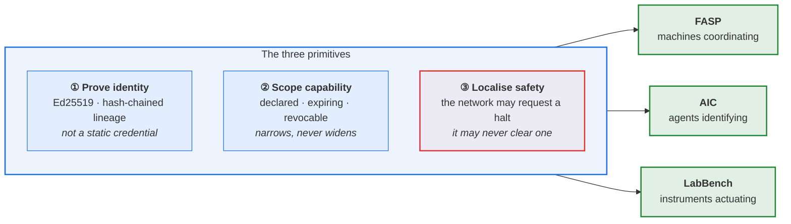

<div align="center">


<br />

<a href="https://www.linkedin.com/in/jayasuryamahadevan"></a>&nbsp;
<a href="mailto:jayasuryamahadevan@gmail.com"></a>&nbsp;


</div>

<br />

```console
$ whoami --verbose

  name        Jayasurya Mahadevan
  works on    protocols and runtimes for autonomous systems
  layers      identity → capability → coordination → safety → decision
  languages   Python · C++17 / CUDA · TypeScript
  method      build the primitive, not the wrapper
  currently   FASP — coordination for machines that share no clock and no frame
```

<br />

## The pattern

I keep arriving at the same three primitives, so I've stopped treating them as
project details and started building them deliberately. Every autonomous system
I work on — a robot fleet, a lab instrument, an AI agent — needs the same
foundation before anything else is safe to build on top.



<div align="center"><sub>Three different domains. One architecture. The third primitive is the one that matters — <b>a signed message must never be able to release a brake or clear an emergency stop.</b></sub></div>

<br />

## Flagship work

<table>
<tr>
<td width="50%" valign="top">

### 🛰️ [FASP](https://github.com/Jayasuryamahadevan/R2R_Communicate)
**A coordination protocol that structurally refuses to become a control system**

Zero-trust coordination for federated autonomous systems. Ed25519 over RFC 8785
canonical JSON, capability-scoped grants, a hash-chained audit log, and a
four-layer model enforced in code — an adapter that exposes a safety function
**fails startup**, not review.

Its spatial layer coordinates machines that share **no clock and no coordinate
frame**: two-way time transfer, Kabsch frame alignment that decays with age, and
guard bands sized at a stated residual risk.

<sub>`16k lines Python` · `559 tests` · `5 runtime deps` · `Apache-2.0`</sub>

</td>
<td width="50%" valign="top">

### 🪪 [Agent ID Card](https://github.com/Jayasuryamahadevan/agent-id-card)
**A living identity chain — not a static passport photo, a lineage**

Self-renewing, tiered-disclosure identity for autonomous agents. An agent
bootstraps its own card, and the chain stays honest as its real capabilities
change.

Deliberately **spec-first**: the deliverable is an exact language-agnostic JSON
format plus algorithms, so a runtime in Go, Rust, or something not yet invented
can conform without touching a line of the reference Python.

<sub>`Ed25519` · `RFC 8785` · `hash-chained` · `spec > implementation`</sub>

</td>
</tr>
<tr>
<td width="50%" valign="top">

### 🔬 [LabBench](https://github.com/Jayasuryamahadevan/Open_Model_Hardware_Standard)
**A USB cable for laboratory hardware**

Plug any AI model into any supported instrument — microscopes over MMCore,
oscilloscopes over SCPI, plate readers over SiLA2 — through one capability model.

A safety kernel **parks every hazardous step on a human signature**, and a
tamper-evident provenance ledger records what actually ran.

<sub>`Python` · `MMCore / SCPI / SiLA2 / LADS` · `provenance ledger`</sub>

</td>
<td width="50%" valign="top">

### 📐 [LP & MILP Solver](https://github.com/Jayasuryamahadevan/LP-and-MLIP-Solver)
**An optimization engine built from first principles**

Sparse revised simplex, branch-and-bound with cutting planes, and a GPU PDLP
implementation — written from the mathematics up in C++17 and CUDA.

**No external solver dependencies.** Not a wrapper around Gurobi or HiGHS; the
simplex itself is the deliverable.

<sub>`C++17` · `CUDA` · `sparse revised simplex` · `B&B + cuts`</sub>

</td>
</tr>
</table>

<br />

## Applied work

Where the infrastructure above gets used, and where the ideas came from.

| Project | What it does | Stack |
|:--|:--|:--|
| **[Genorai Cortex](https://github.com/Jayasuryamahadevan/Advanced-RAGv2)** | Agentic RAG analytics on a three-agent loop — an *Orchestrator* routes, a *Coder* writes `pandas`/`plotly`, and a *Critic* reviews for logic and sandbox-safety **before** execution | `FastAPI` `React` `Plotly` |
| **[AutoSLM v2](https://github.com/Jayasuryamahadevan/AutoML)** | Describe a model in English, get a fine-tuned one — synthetic data, 4-bit QLoRA, an LLM judge, and **automatic retry with adjusted hyperparameters** until it passes | `LangGraph` `Unsloth` `Ollama` |
| **[Saturn Browser](https://github.com/Jayasuryamahadevan/Browserai)** | A browser as an agentic AI OS — assistance, persistent cross-session memory and project-scoped tabs as parts of the shell, not an add-on | `Electron` `TypeScript` |
| **[AgriTwin](https://github.com/Jayasuryamahadevan/vv2.0)** | 3D digital twin of real Coimbatore farmland from OpenStreetMap imagery, with procedural crop models driven by recorded yield | `CesiumJS` `Node` |
| **[7am-arivu](https://github.com/Jayasuryamahadevan/7am-arivu)** | VS Code extension for ClawHub skills — search, preview, safety-check and install with a tracked lockfile | `TypeScript` `VS Code API` |
| **[IntoTheLLMs](https://github.com/Jayasuryamahadevan/IntoTheLLMs-Workshop)** | Teaching agentic workflows live — generates a workflow from a business prompt and shows how an `AGENTS.md` layer changes model behaviour | `JavaScript` `OpenRouter` |

<br />

## How I build

<table>
<tr><td width="34%"><b>🧱 &nbsp;Primitives over wrappers</b></td><td>

A simplex written from the mathematics rather than a call into Gurobi. Ed25519
and RFC 8785 rather than a framework that hides them. If the hard part is the
point of the project, it does not get outsourced.

</td></tr>
<tr><td><b>📦 &nbsp;Dependencies are a liability</b></td><td>

FASP runs on **five** runtime packages, and its linear algebra — Jacobi
eigendecomposition, 3×3 SVD, Cholesky — is pure Python rather than pulling in
NumPy. On an audited edge appliance, every wheel is a supply-chain question.

</td></tr>
<tr><td><b>📄 &nbsp;Specification over implementation</b></td><td>

AIC's deliverable is `SPEC.md`, not its Python. An agent in a language nobody
has written yet should be able to conform from the document alone.

</td></tr>
<tr><td><b>🚦 &nbsp;State the limits</b></td><td>

FASP's safety case marks independent validation *undeveloped* rather than
omitting it, and `hard_realtime` is a constant `False` with reasons attached.
A guarantee you cannot make is worth more written down than implied.

</td></tr>
</table>

<br />

## Tech

<div align="center">


<br /><br />


</div>

<br />

## Activity

<div align="center">

<picture>
  <source media="(prefers-color-scheme: dark)" srcset="https://github-profile-summary-cards.vercel.app/api/cards/profile-details?username=Jayasuryamahadevan&theme=github_dark" />
  
</picture>

<br />

<picture>
  <source media="(prefers-color-scheme: dark)" srcset="https://github-profile-summary-cards.vercel.app/api/cards/repos-per-language?username=Jayasuryamahadevan&theme=github_dark" />
  
</picture>
<picture>
  <source media="(prefers-color-scheme: dark)" srcset="https://streak-stats.demolab.com?user=Jayasuryamahadevan&hide_border=true&theme=github-dark-blue" />
  
</picture>

</div>

<br />

<div align="center">

**Open to collaboration on autonomous-systems infrastructure, robotics coordination, and high-performance numerical computing.**

<sub>Also maintain a fork of <a href="https://github.com/Jayasuryamahadevan/pi">pi</a> — an agent toolkit I extend with a FASP identity bridge.</sub>


</div>
