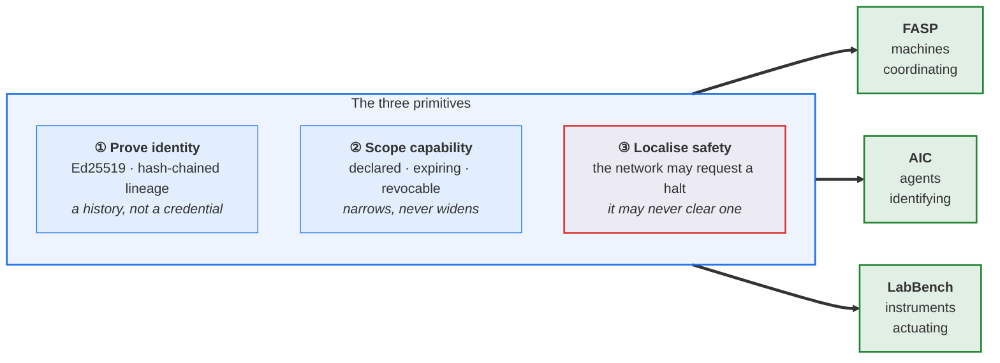
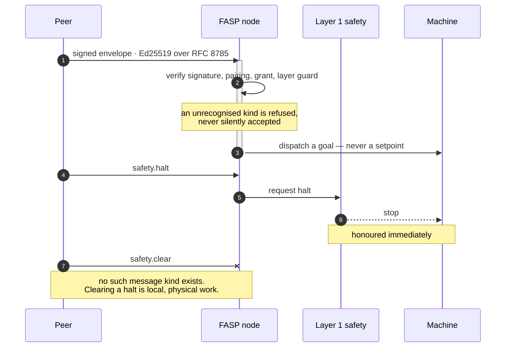

```
╔══════════════════════════════════════════════════════════════════════════════╗
║                                                                              ║
║       ██  █████  ██    ██  █████  ███████ ██    ██ ██████  ██    ██  █████   ║
║       ██ ██   ██  ██  ██  ██   ██ ██      ██    ██ ██   ██  ██  ██  ██   ██  ║
║       ██ ███████   ████   ███████ ███████ ██    ██ ██████    ████   ███████  ║
║  ██   ██ ██   ██    ██    ██   ██      ██ ██    ██ ██   ██    ██    ██   ██  ║
║   █████  ██   ██    ██    ██   ██ ███████  ██████  ██   ██    ██    ██   ██  ║
║                                                  M  A  H  A  D  E  V  A  N   ║
║                                                                              ║
╟──────────────────────────────────────────────────────────────────────────────╢
║                                                                              ║
║   ROLE       Infrastructure for autonomous systems                           ║
║   LAYERS     identity → capability → coordination → safety → decision        ║
║   LANGUAGE   Python  ·  C++17 / CUDA  ·  TypeScript                          ║
║   METHOD     build the primitive, not the wrapper                            ║
║   NOW        FASP — coordination for machines sharing no clock               ║
║                                                                              ║
╟──────────────────────────────────────────────────────────────────────────────╢
║   linkedin.com/in/jayasuryamahadevan    ·    jayasuryamahadevan@gmail.com    ║
╚══════════════════════════════════════════════════════════════════════════════╝
```

<div align="center">
<a href="https://www.linkedin.com/in/jayasuryamahadevan"><b>LinkedIn</b></a> &nbsp;·&nbsp;
<a href="mailto:jayasuryamahadevan@gmail.com"><b>Email</b></a> &nbsp;·&nbsp;
<a href="https://github.com/Jayasuryamahadevan?tab=repositories"><b>All repositories</b></a>
</div>

> [!NOTE]
> **This page loads no external images.** No badge services, no stat cards, no
> render APIs — every element below is drawn by GitHub itself. A profile that
> breaks when a third-party Vercel app returns 503 is making the same mistake
> as a robot that stops when its cloud connection drops.

---

## The pattern

I kept arriving at the same three primitives, so I stopped treating them as
project details and started building them on purpose. A robot fleet, a
laboratory instrument and an AI agent are different problems that need the
same foundation before anything on top of them is safe.



The third one is the load-bearing idea. **A signed message must never be able
to release a brake or clear an emergency stop** — no matter how well
authenticated its sender is. Authority over stopping belongs to certified
hardware standing next to the machine, and every protocol I write is shaped
around keeping it there.

Here is what that actually looks like on the wire:



---

## Flagship work

<table>
<tr><td width="50%" valign="top">

### 🛰️ &nbsp;[FASP](https://github.com/Jayasuryamahadevan/R2R_Communicate)

**A coordination protocol that structurally refuses to become a control system.**

Zero-trust coordination for federated autonomous systems — Ed25519 over RFC 8785
canonical JSON, capability-scoped grants, a hash-chained audit log, and a
four-layer model enforced in code. An adapter exposing a safety function **fails
startup**, not review.

Its spatial layer coordinates machines sharing **no clock and no coordinate
frame**: two-way time transfer, Kabsch alignment that decays with age, and guard
bands sized at a stated residual risk.

```
16,275 lines Python     559 tests
5 runtime deps          Apache-2.0
```

</td><td width="50%" valign="top">

### 🪪 &nbsp;[Agent ID Card](https://github.com/Jayasuryamahadevan/agent-id-card)

**A living identity chain — not a passport photo, a lineage.**

Self-renewing, tiered-disclosure identity for autonomous agents. An agent
bootstraps its own card, and the chain stays honest as its real capabilities
change over time.

Deliberately **spec-first**: the deliverable is `SPEC.md` — an exact
language-agnostic JSON format plus algorithms — so a runtime in Go, Rust or
something not yet invented can conform without reading the reference Python.

```
Ed25519                 RFC 8785 JCS
hash-chained            spec > implementation
```

</td></tr>
<tr><td width="50%" valign="top">

### 🔬 &nbsp;[LabBench](https://github.com/Jayasuryamahadevan/Open_Model_Hardware_Standard)

**A USB cable for laboratory hardware.**

Plug any AI model into any supported instrument — microscopes over MMCore,
oscilloscopes over SCPI, plate readers over SiLA2 — through one capability model.

A safety kernel **parks every hazardous step on a human signature**, and a
tamper-evident provenance ledger records what actually ran.

```
MMCore · SCPI           SiLA2 · LADS
safety kernel           provenance ledger
```

</td><td width="50%" valign="top">

### 📐 &nbsp;[LP & MILP Solver](https://github.com/Jayasuryamahadevan/LP-and-MLIP-Solver)

**An optimization engine built from the mathematics up.**

Sparse revised simplex, branch-and-bound with cutting planes, and a GPU PDLP
implementation, written from first principles in C++17 and CUDA.

**No external solver dependencies.** Not a wrapper around Gurobi or HiGHS — the
simplex itself is the deliverable.

```
C++17 · CUDA            sparse revised simplex
branch & bound          GPU PDLP
```

</td></tr>
</table>

---

## The arithmetic I actually write

Four expressions from four different projects — the parts that had to be right.
A page about systems engineering should be willing to show one.

**Reduced cost** · *revised simplex — which column enters the basis, priced without ever forming* $B^{-1}$

$$\bar{c}_j = c_j - c_B^{\top} B^{-1} A_j$$

**Two-way time transfer** · *the offset between two clocks that have never met*

$$\theta = \frac{(t_2 - t_1) + (t_3 - t_4)}{2}$$

**Clock divergence** · *why 50 ppm of skew is 180 ms of drift per hour*

$$C(t) = (1 + \alpha)\,t + \beta$$

**Guard-band coverage factor** · *how many* $\sigma$ *bound a position at residual risk* $\alpha$

$$k = \sqrt{-2\ln\alpha} \quad\Longrightarrow\quad k \approx 5.26 \;\text{ at }\; \alpha = 10^{-6}$$

> [!TIP]
> The last one is why FASP never returns a bare position. Two robots closing at
> a combined 5 m/s are **5 cm apart per millisecond** of clock disagreement, so
> a timestamp is an interval, a pose is a mean and a covariance, and a
> separation verdict quotes the risk it was decided at.

---

## How I build

> [!IMPORTANT]
> **Primitives over wrappers.** A simplex written from the mathematics rather
> than a call into Gurobi. Ed25519 and RFC 8785 rather than a framework that
> hides them. If the hard part is the point of the project, it does not get
> outsourced.

> [!WARNING]
> **Dependencies are a liability.** FASP runs on **five** runtime packages, and
> its linear algebra — Jacobi eigendecomposition, 3×3 SVD, Cholesky — is pure
> Python rather than pulling in NumPy. On an audited edge appliance, every
> wheel is a supply-chain question. This page follows the same rule.

> [!NOTE]
> **Specification over implementation.** AIC's deliverable is `SPEC.md`, not its
> Python. An agent written in a language nobody has invented yet should be able
> to conform from the document alone.

> [!CAUTION]
> **State the limits.** FASP's safety case marks independent validation
> *undeveloped* rather than omitting it, and `hard_realtime` is a constant
> `False` with its reasons attached. A guarantee you cannot make is worth more
> written down than quietly implied.

---

## Applied work

<table>
<tr><th align="left">Project</th><th align="left">What it does</th><th align="left">Stack</th></tr>
<tr><td><a href="https://github.com/Jayasuryamahadevan/Advanced-RAGv2"><b>Genorai Cortex</b></a></td><td>Agentic RAG analytics on a three-agent loop — an <i>Orchestrator</i> routes, a <i>Coder</i> writes <code>pandas</code>/<code>plotly</code>, and a <i>Critic</i> reviews for logic and sandbox-safety <b>before</b> execution</td><td><sub>FastAPI · React · Plotly</sub></td></tr>
<tr><td><a href="https://github.com/Jayasuryamahadevan/AutoML"><b>AutoSLM v2</b></a></td><td>Describe a model in English, get a fine-tuned one — synthetic data, 4-bit QLoRA, an LLM judge, and <b>automatic retry with adjusted hyperparameters</b> until it passes</td><td><sub>LangGraph · Unsloth · Ollama</sub></td></tr>
<tr><td><a href="https://github.com/Jayasuryamahadevan/Browserai"><b>Saturn Browser</b></a></td><td>A browser as an agentic AI OS — assistance, persistent cross-session memory and project-scoped tabs as parts of the shell rather than an add-on</td><td><sub>Electron · TypeScript</sub></td></tr>
<tr><td><a href="https://github.com/Jayasuryamahadevan/vv2.0"><b>AgriTwin</b></a></td><td>3D digital twin of real Coimbatore farmland from OpenStreetMap imagery, with procedural crop models driven by recorded yield</td><td><sub>CesiumJS · Node</sub></td></tr>
<tr><td><a href="https://github.com/Jayasuryamahadevan/7am-arivu"><b>7am-arivu</b></a></td><td>VS Code extension for ClawHub skills — search, preview, safety-check and install with a tracked lockfile</td><td><sub>TypeScript · VS Code API</sub></td></tr>
<tr><td><a href="https://github.com/Jayasuryamahadevan/IntoTheLLMs-Workshop"><b>IntoTheLLMs</b></a></td><td>Teaching agentic workflows live — generates a workflow from a business prompt and shows how an <code>AGENTS.md</code> layer changes model behaviour</td><td><sub>JavaScript · OpenRouter</sub></td></tr>
</table>

---

## Working vocabulary

```
LANGUAGES     Python  ·  C++17  ·  CUDA  ·  TypeScript  ·  JavaScript
CRYPTO        Ed25519  ·  RFC 8785 JCS  ·  hash chains  ·  mTLS
ROBOTICS      ROS 2 / DDS  ·  VDA 5050  ·  OPC UA  ·  Modbus/TCP  ·  MAVLink
STANDARDS     IEC 62443  ·  IEC 61508 black channel  ·  CycloneDX SBOM
NUMERICS      revised simplex  ·  branch & bound  ·  PDLP  ·  SE(3) estimation
AI            LangGraph  ·  QLoRA / Unsloth  ·  Ollama  ·  agentic RAG
RUNTIME       SQLite WAL  ·  Starlette / ASGI  ·  Electron  ·  Docker
```

---

<div align="center">

**Open to collaboration on autonomous-systems infrastructure,<br/>robotics coordination, and high-performance numerical computing.**

<br/>

<sub>I also maintain a fork of <a href="https://github.com/Jayasuryamahadevan/pi">pi</a>, an agent toolkit, extended with a FASP identity bridge.</sub>

<br/><br/>

<samp>build the primitive, not the wrapper</samp>

</div>
